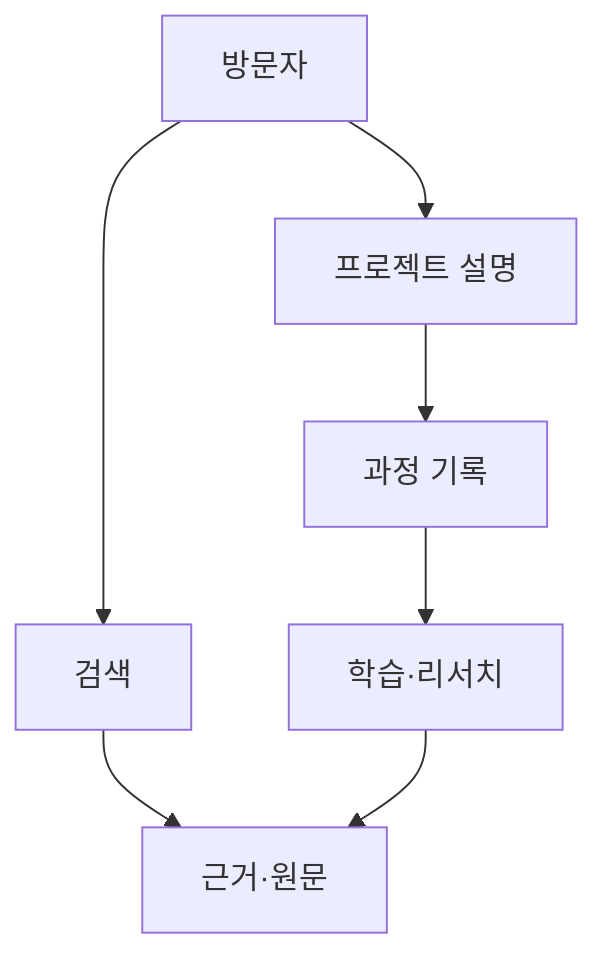

# 03. 사이트맵과 방문 흐름

> v5.0 기준: [[SCOPE_v5]] 적용. 주력 Kotlin·Rust·TypeScript·PostgreSQL. LLM·C++ 제외, Go는 국소 배포 도구로 필요할 때만 사용합니다. 로컬 자원은 [[02_RESOURCE_BUDGET]] 참조.
프로젝트, 학습, 근거를 서로 연결

## 상단 메뉴

소개 / 프로젝트 / 노트 / 리서치 / 탐색. 홈은 로고로 접근합니다. 탐색은 검색전용이며 질문 생성 기능은 이번범위에서 제외합니다.

## 대표 경로

/about, /projects, /projects/{slug}, /projects/{slug}/logs, /logs/{slug}, /notes, /notes/{slug}, /research, /research/{slug}, /explore, /topics/{slug}, /series/{slug}. 검색 조건은 쿼리로 표현하고 필터 조합의 무제한 색인을 피합니다.

## 화면 상태

목록·상세·빈 목록·검색 결과 없음·404·오류를 정의합니다. 모바일에서 메뉴와 목차를 접고 키보드 조작·명도 대비·터치 영역을 확인합니다. 자료가 없는 프로젝트는 준비 상태를 명확히 표시합니다.

## 다이어그램

## v5.0 자료 워크플로 반영

공개 메뉴는 유지합니다. 관리자 전용 /admin/imports, /admin/imports/new, /admin/imports/:id/review를 추가합니다. [[A13]] [[A14]] [[A15]]
