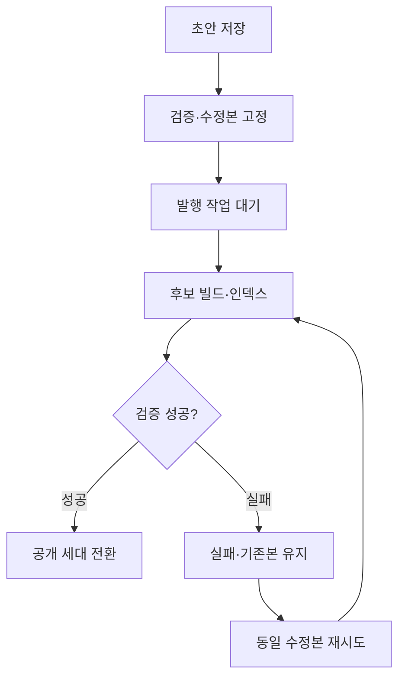

# 05. 저장과 공개의 상태 모델

> v5.0 기준: [[SCOPE_v5]] 적용. 주력 Kotlin·Rust·TypeScript·PostgreSQL. LLM·C++ 제외, Go는 국소 배포 도구로 필요할 때만 사용합니다. 로컬 자원은 [[02_RESOURCE_BUDGET]] 참조.
발행은 배포 완료를 확인하는 영속 작업

## 구분할 상태

Entry는 draft_revision_id와 published_revision_id를 분리합니다. PublicationJob은 QUEUED/BUILDING/DEPLOYING/SUCCEEDED/FAILED/CANCELED를 가집니다. 예약 시각은 별도 필드이며 Asia/Seoul 입력을 UTC로 저장합니다.

## 핵심 불변조건

발행 대상 수정본은 고정합니다. 공개 글을 수정해도 초안이 방문자에게 보이지 않습니다. 동일 요청 키의 중복 클릭은 하나의 작업으로 처리합니다. 사이트별 발행을 직렬화하고 오래된 세대의 완료가 최신 공개본을 덮어쓰지 못하게 합니다.

## 복원·철회

이전 버전 복원은 새 초안을 생성하며 공개는 별도 발행입니다. 비공개는 먼저 API·검색에서 해당 ID를 차단하고, 정적 페이지/첨부/CDN을 철회합니다. 외부 캐시는 즉시 회수할 수 없음을 운영 화면에서 구분합니다.

## 다이어그램

