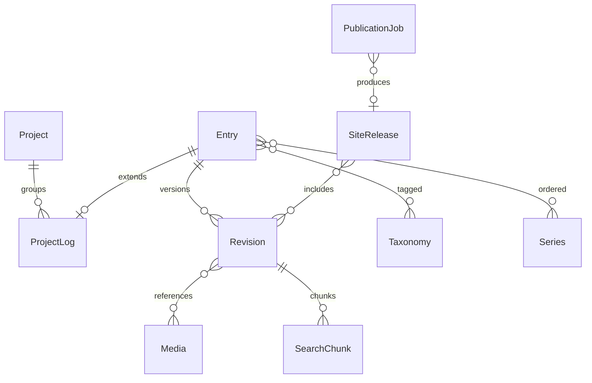

# 11. DB 논리 구조

> v5.0 기준: [[SCOPE_v5]] 적용. 주력 Kotlin·Rust·TypeScript·PostgreSQL. LLM·C++ 제외, Go는 국소 배포 도구로 필요할 때만 사용합니다. 로컬 자원은 [[02_RESOURCE_BUDGET]] 참조.
프로젝트와 기록, 수정본과 공개 세대를 분리

## 원본과 파생물

PostgreSQL의 Entry·Revision이 원본입니다. ProjectLog는 Entry의 확장 관계입니다. HTML·검색 인덱스·LLM 응답 캐시는 재생성 가능한 파생물입니다. 공개 세대는 포함한 수정본을 명시적으로 기록합니다.

## 본문 모델

Revision에 schema_version과 body_json을 저장합니다. 공통 필드는 컬럼으로, 논문·뉴스의 유연한 확장 필드는 검증된 JSON으로 관리합니다. 큰 이미지와 모델 파일은 DB 본문에 넣지 않습니다.

## 다이어그램

## v5.0 자료 워크플로 반영

ingestion 6개 업무 테이블과 별도 checkpoint 영역을 추가합니다. [[WF04_DATA_API]]
