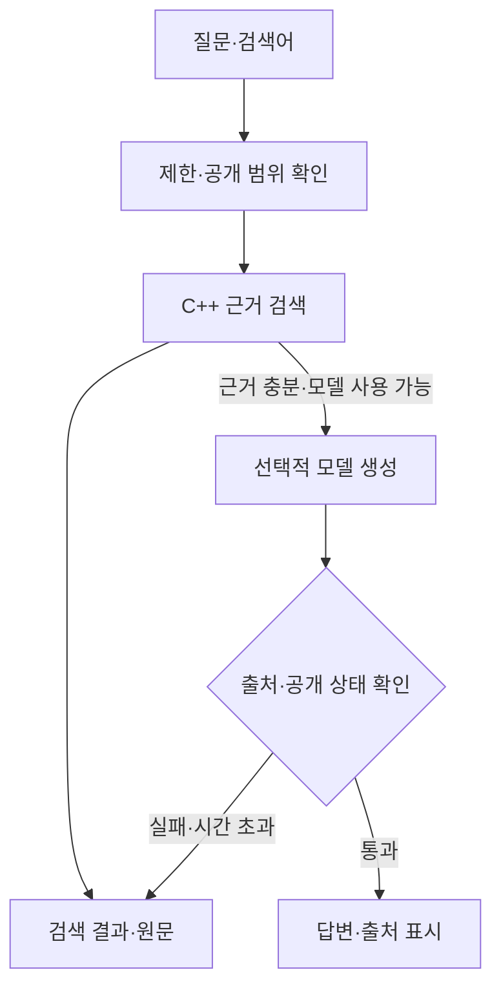

# 13. C++ 검색·소형 모델 RAG

검색 기능은 필수, 생성은 품질·비용 게이트 후 공개

## 검색 엔진

공개 스냅샷의 chunk를 읽어 키워드 검색 인덱스를 구성합니다. 초기에는 SQLite FTS5 등 검증된 검색 라이브러리를 사용하는 C++ 모듈을 후보로 둡니다. 한국어 띄어쓰기·조사·기술 용어 검색을 평가해 정규화와 n-gram 전략을 결정합니다.

## 모델 연결

기존 소형 모델을 llama.cpp로 실행하고 C++ 어댑터가 근거와 생성 파라미터를 전달합니다. 모델을 처음부터 학습하지 않습니다. 모델 라이선스·한국어 품질·양자화·메모리·응답 시간을 평가한 뒤 선정합니다.

## 다이어그램

