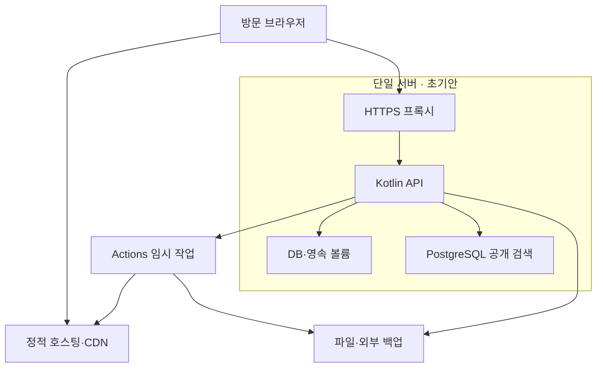

# 16. 인프라와 컨테이너 배치

> v5.0 기준: [[SCOPE_v5]] 적용. 주력 Kotlin·Rust·TypeScript·PostgreSQL. LLM·C++ 제외, Go는 국소 배포 도구로 필요할 때만 사용합니다. 로컬 자원은 [[02_RESOURCE_BUDGET]] 참조.
단일 서버 + 정적 배포 + 필요 시 실행 작업

## 초기 물리 배치

공개 웹·관리자 정적 파일은 호스팅/CDN에 둡니다. 작은 서버 한 대에 프록시·Kotlin API·PostgreSQL(공개 검색 포함)을 둡니다. 별도 모델 컨테이너는 배치하지 않습니다. 실제 메모리를 측정하기 전 서버 사양을 확정하지 않습니다.

## 네트워크·파일

외부에는 HTTPS 진입점만 노출하고 DB·검색은 내부 네트워크로 제한합니다. 초안 첨부는 비공개 객체와 만료 링크로 접근합니다. 공개 자산의 이전 경로와 CDN 철회 방법까지 정의합니다. 서버 외부에 백업을 둡니다.

## 다이어그램

## v5.0 자료 워크플로 반영

Python은 workflow profile의 one-shot 워커로 추가하며 timer는 배포 시 선택합니다. 별도 broker/model 서버는 없습니다. [[WF06_OPERATIONS]]
