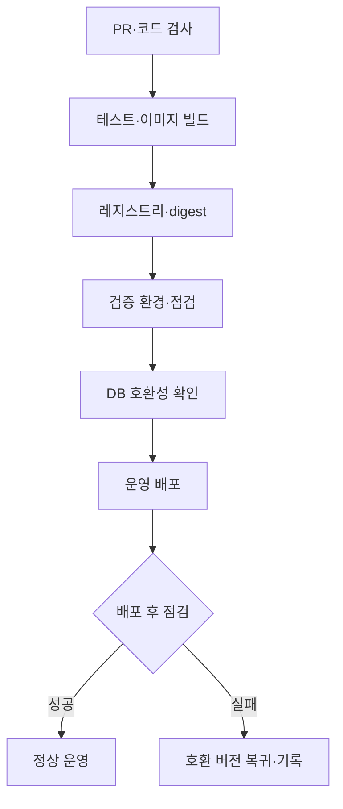

# 17. CI/CD와 콘텐츠 배포

> v5.0 기준: [[SCOPE_v5]] 적용. 주력 Kotlin·Rust·TypeScript·PostgreSQL. LLM·C++ 제외, Go는 국소 배포 도구로 필요할 때만 사용합니다. 로컬 자원은 [[02_RESOURCE_BUDGET]] 참조.
프로그램 릴리스와 글 발행의 결과물을 구분

## 코드 파이프라인

PR에서 검사·단위/계약/핵심 통합 테스트 → 이미지 빌드·검사·SBOM → 레지스트리 → 검증 → 운영 → 상태 점검(Go 도구는 필요 시 도입). 검증한 동일 digest를 배포합니다. GitHub 환경 기능은 실제 요금제·저장소 공개 조건을 확인합니다.

## 콘텐츠 파이프라인

발행 작업이 고정된 DB 스냅샷을 인증된 경로로 내보냅니다. 임시 작업에서 Rust 검증 → Astro 빌드 → 검색 인덱스 생성 → 후보 검증 → 공개 전환을 실행합니다. CI에 운영 DB 직접 접근 권한은 주지 않습니다.

## 다이어그램

## v5.0 자료 워크플로 반영

Python 경로별 lint/type/fixture/계약 검사와 workflow 이미지 job을 추가합니다. checkpoint 호환성을 배포 게이트에 포함합니다. [[M8-08]]
