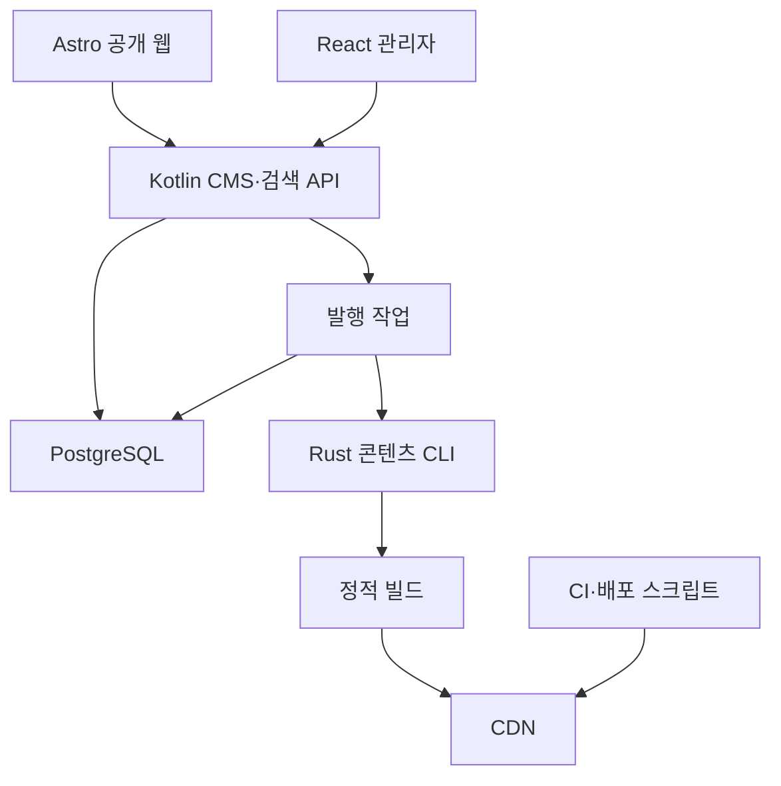

# 전체 구성 — v5.0

Go는필요한국소CLI에만조건부추가합니다. C++/LLM 서비스는 없습니다. Python 자료 처리 워커는 요청 시 실행합니다.

## Python 확장 구조

자료 처리 구성은 [[09_workflow_components]], 전체 과정은 [[08_document_workflow]], 승인·재개는 [[10_review_resume]]를 참조합니다.
