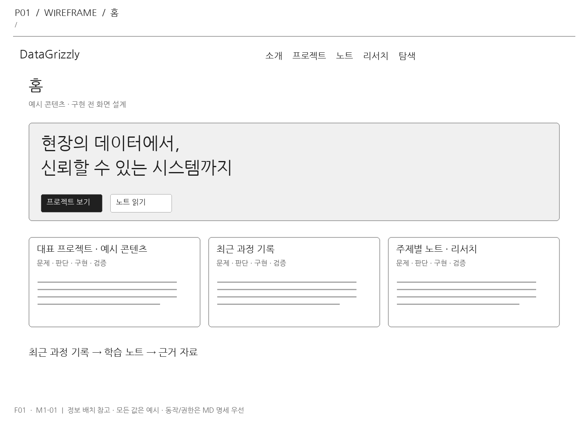
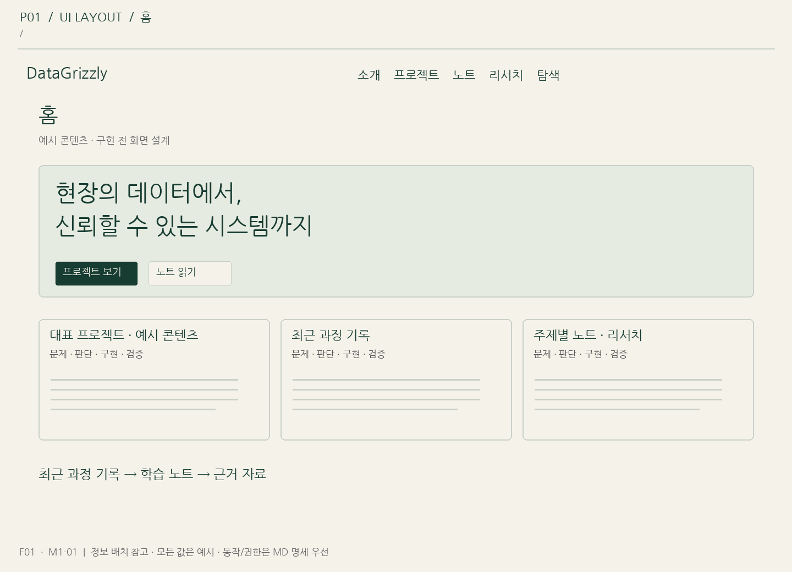

# P01 홈

- 경로: `/` (관리 경로는 운영 라우팅 확정 시 조정)
- 연결 기능: F01
- 기본 구현 태스크: [M1-01](../04_tasks/M1-01.md)
- 상태: M1-01에서 네 구역을 정적 홈에 표시한다. M1-02에서 대표 프로젝트와 과정 기록 제목을 각각의 상세 주소로 연결했다. 노트·리서치 상세와 API 응답 교체는 아직이라 아래 확인란은 비워 둔다.

## 화면 구역

1. 브랜드 소개와 두 가지 시작점
2. 대표 프로젝트 · 예시 콘텐츠
3. 최근 과정 기록
4. 주제별 노트 · 리서치

## 화면과 이미지

## 동작·상태 기준

연결 기능 명세의 권한·데이터·오류 계약을 적용합니다. 읽기 화면은 공개 데이터만, 관리 화면은 소유자 인증 이후에 제공합니다. 로딩·빈 데이터·실패 상태를 숨기지 않습니다. 화면의 예시 데이터를 실제 API 응답으로 교체하고 임의의 성공 상태를 하드코딩하지 않습니다.

## 구현 확인

- [ ] 위 구역과 해당 라우트가 연결되었습니다.
- [ ] 클릭 후 이동/저장/처리 결과가 실제 계약에 맞습니다.
- [ ] 모바일·키보드·빈 상태·오류를 확인했습니다.
- [ ] 예시와 실제 콘텐츠를 구분하고 공개/초안 경계를 확인했습니다.

## v5.0 PC·범위 적용

화면은실제API와연결하되목록은페이지분할,이미지는지연로딩,전체본문/이미지를한번에브라우저상태에넣지않습니다. 참고PNG는v3.1디자인자료입니다. 그림의질문패널·모델상태·C++배지는이번구현에서제외하고현재명세를따릅니다.
